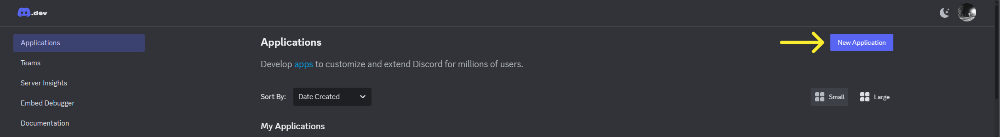
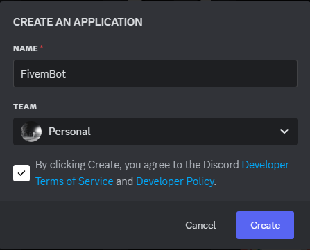
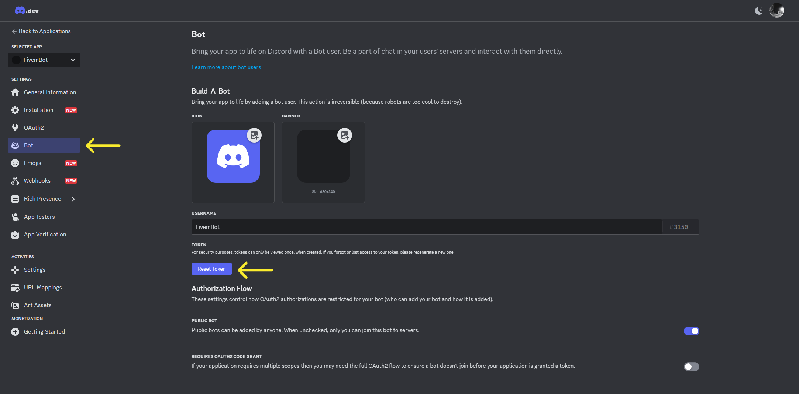
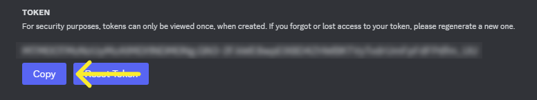
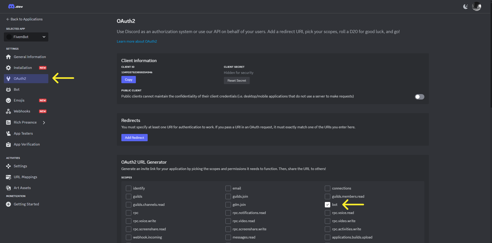
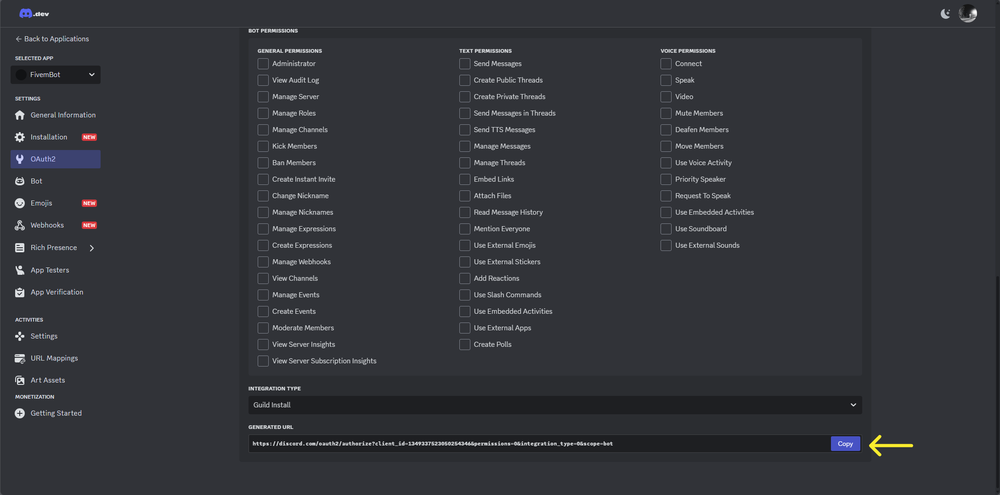
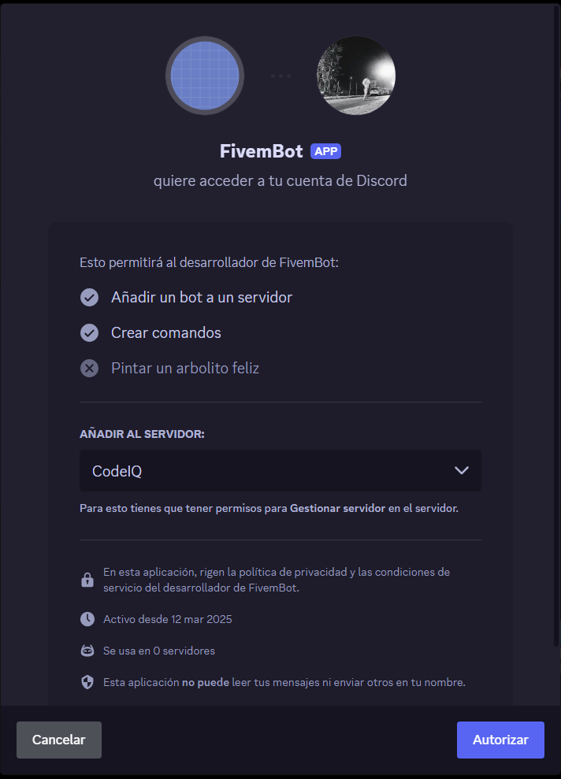

import { Steps, Tabs, Tab } from 'nextra-theme-docs';
import { Callout } from 'nextra/components';

# Discord Bot Creation

Follow this guide to create a Discord Bot and join it to your guild.

<Steps>
    ### Create Application

    Enter on the [Discord Developer Portal](https://discord.com/developers/applications) and click on the button on `New Application`, after that introduce the name for the bot, accept the terms and click on `Create`.Steps

     
     

     ### Reset Token

     Go to the `Bot` section and select the button of `Reset Token`, then copy the token and safe it to configure the step of the [cq-lib](../installation)

     
     

     ### Join Into a Guild

     Navigate into the `OAuth2` section and select the checkbox of `bot` in the **OAuth2 URL Generator** box. Then go to the bottom of the page and select the `copy` button, after that you will only need to open the URL on a new tab and select the guild you want to join the bot.

     
     
     
</Steps>