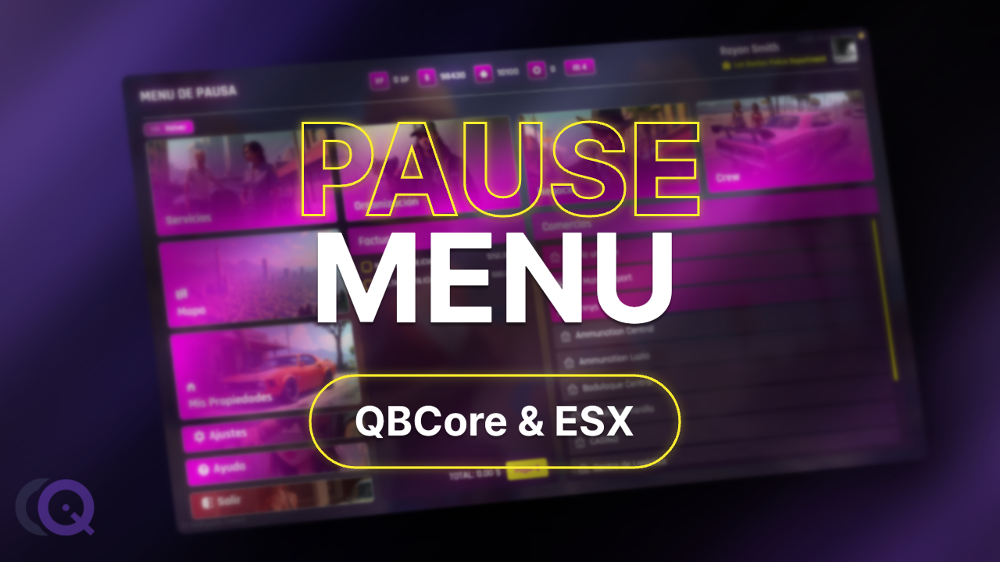

{/* --- */}
{/* title: CodeIQ Pause Menu */}
{/* --- */}

import { Callout } from 'nextra/components';

# CodeIQ Pause Menu

We are excited to introduce our **pause menu** script! This guide will walk you through configuring and customizing the resource to suit your needs.

## Features

The **pause menu** script offers:

- Customizable logos and background images.
- Sound effects for menu actions (hover, click, transitions).
- Configurable menu options with toggling features.
- Flexible shortcut options with icon or image-based customization.
- Integration with `cq-lib` for event-driven menu actions. **[Check the documentation for cq-lib](./cq-lib)**
- Integration with `cq-bills` for invoice menu. **[Check the documentation for cq-bills](./cq-bills)**

<Callout type="warning">

This script requires **`cq-lib`** as a core dependency. Make sure it is installed and functional for the pause menu to work.
Additionally, it uses the **`cq-bills`** script as a dependency for the operation of the invoice menu.

</Callout>